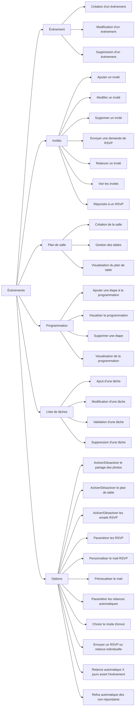
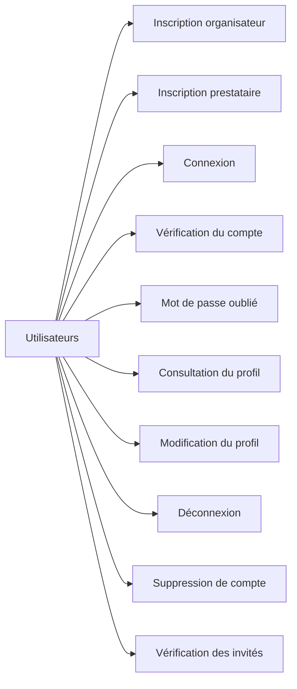
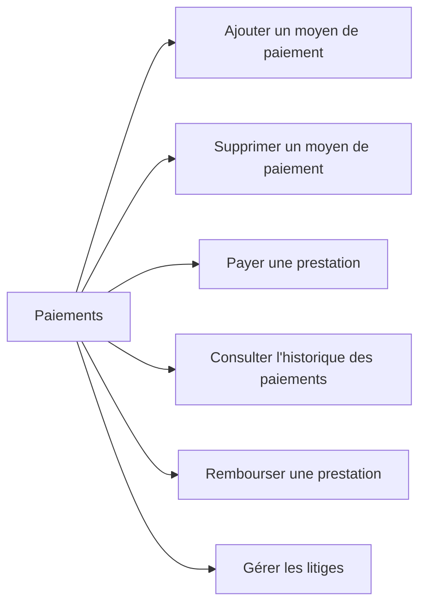
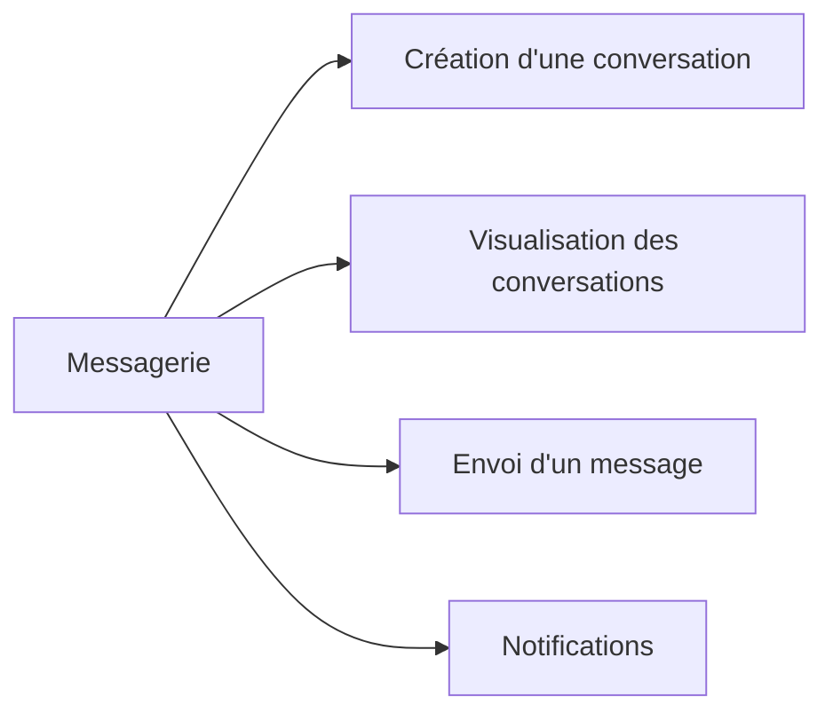
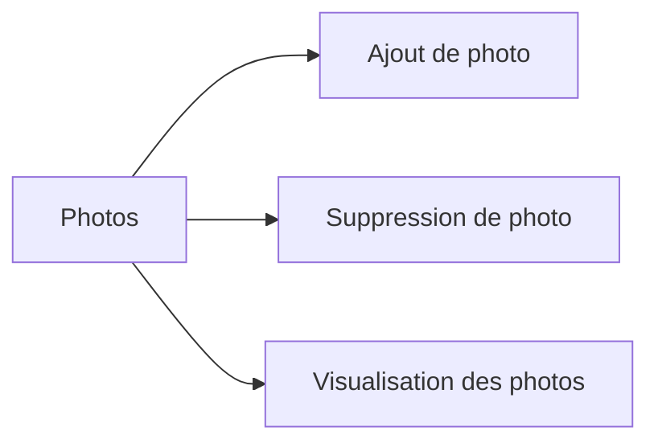
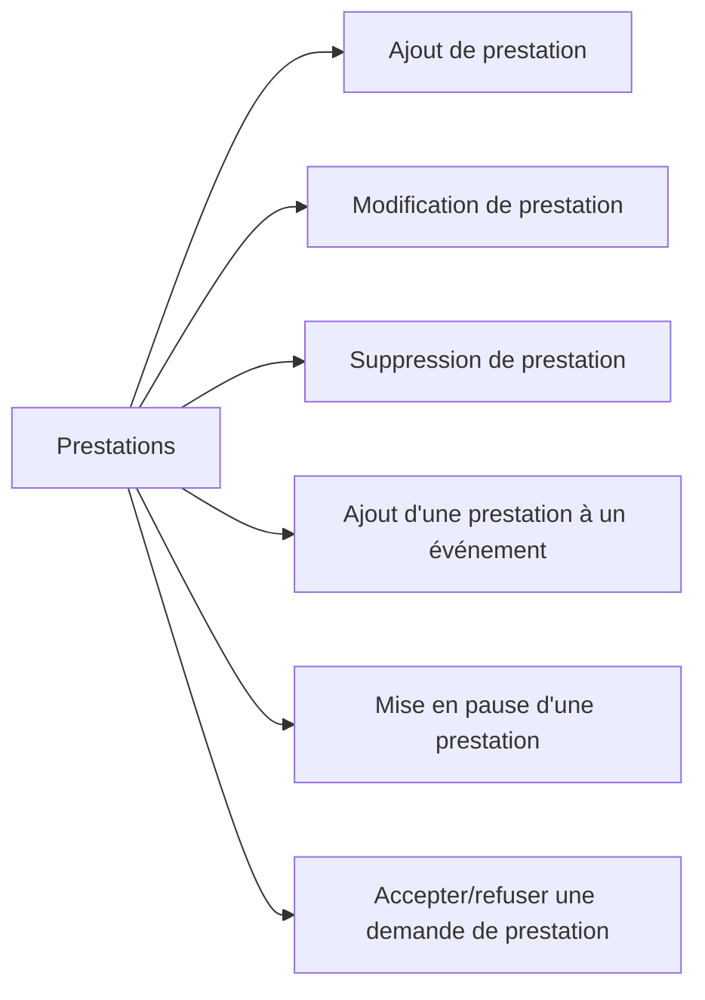
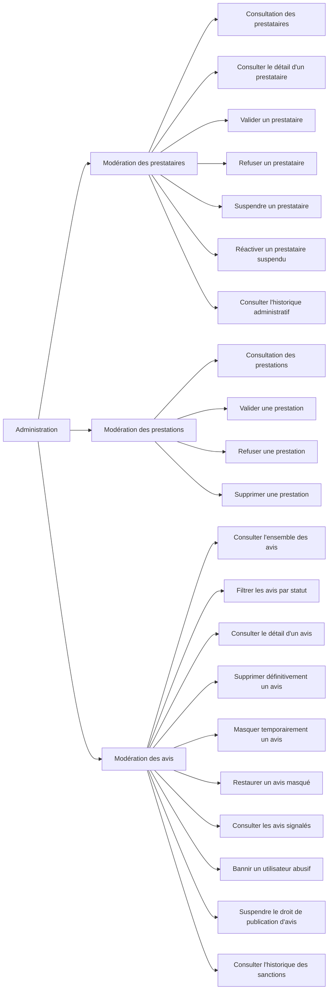

# WBS - Work Breakdown Structure

Un diagramme par domaine. La source est `../specifications/wbs/` (un fichier par domaine, avec son PDF d’une page).

## Événements

## Utilisateurs

## Paiements

## Messagerie

## Photos

## Prestations

## Administration

