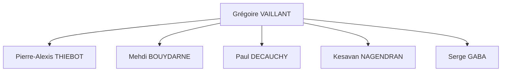

# Structure organisationnelle du projet (OBS)

## Clarté hiérarchique

Nous adoptons une structure volontairement horizontale afin de favoriser la communication, l’autonomie et la réactivité.

Chaque membre est responsable de son périmètre technique tout en contribuant aux décisions collectives.

Cependant, afin d’éviter tout blocage décisionnel :

- Grégoire VAILLANT occupe le rôle de décisionnaire final (en cas de désaccord ou de nécessité de trancher, la décision finale est prise par Grégoire.).
- Cette organisation permet de maintenir un équilibre entre collaboration ouverte et efficacité stratégique.

## Cartographie des compétences

La cartographie des compétences est présentée ci-dessous, avec trois niveaux : Notions, Intermédiaire, Maîtrisé.

| Domaine / compétence | Pierre-Alexis | Mehdi | Paul | Grégoire | Kesavan | Serge |
|---|:-:|:-:|:-:|:-:|:-:|:-:|
| **Frontend** | | | | | |  |
| React / Flutter | Intermédiaire | Intermédiaire | Maîtrisé | Maîtrisé | |  |
| TypeScript | Intermédiaire | Notions | Intermédiaire | Maîtrisé | |  |
| UI / UX & Figma | Notions | Intermédiaire | Intermédiaire | Maîtrisé | |  |
| State management | Notions | Intermédiaire | Intermédiaire | Intermédiaire | |  |
| **Backend** | | | | | |  |
| Go / Echo / Ogen | Maîtrisé | Notions | Maîtrisé | Notions | |  |
| API REST & OpenAPI | Maîtrisé | Maîtrisé | Maîtrisé | Maîtrisé | |  |
| WebSocket / temps réel | Maîtrisé | Intermédiaire | Intermédiaire | Maîtrisé | |  |
| Workflows asynchrones | Maîtrisé | Maîtrisé | Maîtrisé | Intermédiaire | |  |
| **Base de données** | | | | | |  |
| MongoDB | Intermédiaire | Maîtrisé | Maîtrisé | Maîtrisé | |  |
| Modélisation de données | Maîtrisé | Maîtrisé | Maîtrisé | Intermédiaire | |  |
| **DevOps / Infra** | | | | | |  |
| Docker / Compose | Maîtrisé | Intermédiaire | Maîtrisé | Intermédiaire | |  |
| CI/CD (GitHub Actions) | Intermédiaire | Maîtrisé | Intermédiaire | Intermédiaire | |  |
| Linux / VPS | Maîtrisé | Maîtrisé | Intermédiaire | Intermédiaire | |  |
| Monitoring / SIEM | Intermédiaire | Maîtrisé | Intermédiaire | Notions | |  |
| Object Storage (S3) | Intermédiaire | Notions | Notions | Maîtrisé | |  |
| **Sécurité** | | | | | |  |
| Cybersécurité applicative | Maîtrisé | Maîtrisé | Intermédiaire | Intermédiaire | |  |
| Auth / JWT / OAuth | Maîtrisé | Maîtrisé | Maîtrisé | Maîtrisé | |  |
| Durcissement infra | Intermédiaire | Maîtrisé | Intermédiaire | Intermédiaire | |  |
| Pentesting | Intermédiaire | Intermédiaire | Notions | Notions | |  |
| RGPD / conformité | Intermédiaire | Intermédiaire | Intermédiaire | Notions | |  |
| **IA** | | | | | |  |
| Python | Maîtrisé | Intermédiaire | Intermédiaire | Intermédiaire | |  |
| PyTorch / ML | Intermédiaire | Notions | Notions | Intermédiaire | |  |
| Computer Vision / facial | Notions | Notions | Notions | Notions | |  |
| Algorithmique avancée | Intermédiaire | Notions | Intermédiaire | Intermédiaire | |  |
| Intégration LLM / API IA | Intermédiaire | Notions | Intermédiaire | Maîtrisé | |  |
| **Test & Quality** | | | | | |  |
| Tests unitaires (Go/pytest) | Intermédiaire | Intermédiaire | Maîtrisé | Notions | |  |
| Tests E2E | Intermédiaire | Intermédiaire | Maîtrisé | Intermédiaire | |  |
| Code review | Maîtrisé | Intermédiaire | Maîtrisé | Maîtrisé | |  |
| **Organisation / Gestion** | | | | | |  |
| Product Owner / roadmap | Notions | Notions | Notions | Maîtrisé | |  |
| Scrum / ClickUp | Notions | Intermédiaire | Notions | Maîtrisé | |  |
| Rédaction de specs | Notions | Notions | Maîtrisé | Maîtrisé | |  |
| Communication client | Notions | Notions | Intermédiaire | Maîtrisé | |  |

Cette cartographie permet d’identifier rapidement :

- Les compétences principales de chaque membre
- Les domaines d’expertise
- Les besoins d’accompagnement ou de montée en compétence
- Les personnes référentes par périmètre technique

## Définition des rôles

### Mehdi BOUYDARNE : Développeur opérationnel

Après 3 ans de parcours généraliste en informatique, je me suis spécialisé en Cybersécurité et Cloud.

En alternance au sein de la cellule cyber d’une PME, je travaille sur l’automatisation et l’industrialisation des déploiements, la gestion d’infrastructure et la surveillance (mise en place d’une infrastructure de collecte/monitoring, construction d’un SIEM). Je contribue également à la sécurisation de l’infrastructure (durcissement, contrôle des accès, bonnes pratiques d’exploitation).

### Paul DECAUCHY : Développeur backend

Développeur backend spécialisé en Go, j’évolue actuellement chez Ubisoft au sein du Lab, une entité dédiée à l’exploration de nouveaux usages technologiques.

Je conçois des systèmes backend distribués en appliquant les principes du Domain-Driven Design (DDD), une approche qui consiste à structurer l’architecture autour du métier afin de garantir cohérence et évolutivité.

Je travaille notamment sur l’implémentation de workflows asynchrones via Uber Cadence, ce qui implique la gestion de processus complexes et de longue durée, avec des mécanismes de reprise automatique en cas d’erreur et de maintien de la cohérence des données.

J’interviens également sur l’intégration des données avec les serveurs de jeu, en veillant à assurer performance, fiabilité et qualité logicielle.

### Pierre-Alexis THIEBOT : Développeur IA / ALGO

Mon profil plutôt technique. Après 3ans en développement de jeux-vidéo où j’ai développé de solides compétences en algorithmique et en optimisation, je suis actuellement en spé cybersécurité, ce apporte une compréhension des architectures, des performances et des enjeux liés à la sécurité des systèmes.

Je travaille aussi dans une startup développant un SaaS de simulation de campagnes de phishing à des fins de sensibilisation, où je touche à tout sauf au front.

J’y ai notamment développé un **evil proxy** (proxy intermédiaire capable d’intercepter et de relayer des flux pour analyser des mécanismes d’authentification dans un cadre de test), des systèmes d’envoi de campagnes de phishing simulées ainsi que des mécanismes de sécurisation. Cette expérience renforce mon intérêt pour les systèmes intelligents, l’automatisation et la compréhension fine des architectures techniques.

Même si je ne suis pas en spé IA, l’IA et la conception d’algorithmes sont des domaines qui me passionnent particulièrement.

### Kesavan NAGENDRAN : Développeur Cyber sécurité et opérationnel

En alternance depuis un an et demi en tant qu'Analyste SOC, j'évolue au quotidien dans la détection, l'analyse et la réponse aux incidents de sécurité. Pour cela, je m'appuie activement sur des solutions de type SIEM, SOAR et EDR, ce qui me donne une vision très concrète des menaces actuelles et des mécanismes de défense.

Fort de cette expérience de terrain et passionné par l'audit, mon rôle au sein du projet s'apparente à celui d’un pentester. J'ai pour mission d'analyser et de décortiquer les stacks technologiques modernes que nous utilisons afin d'en comprendre précisément les rouages, les interactions et les limites.

Mon objectif principal est d'éprouver ces architectures en traquant les vulnérabilités et en identifiant les potentielles failles de sécurité. En adoptant cette approche offensive (complémentaire à mon profil défensif), je ne me contente pas de relever les problèmes : je propose également des axes d'amélioration concrets et des recommandations techniques pour durcir nos systèmes, garantissant ainsi la robustesse et la fiabilité de notre projet.

### Serge GABA : Développeur Frontend Mobile

Développeur Flutter/Dart passionné par le multiplateforme (iOS et Android), je me spécialise aujourd'hui en cybersécurité et architecture des systèmes d'information dans le cadre de mon MSc à Epitech Paris.

J'ai développé et déployé plusieurs applications mobiles en Flutter, en m'appuyant sur une architecture Clean Architecture avec BLoC/Riverpod/GetX côté frontend, et Node.js/PostgreSQL/MongoDB côté backend.

Sur ce projet, mon rôle est d'assurer le développement de l'application mobile, en veillant à ce qu'elle s'intègre proprement avec les briques backend et infrastructure construites par le reste de l'équipe, tout en appliquant les bonnes pratiques de sécurité côté client

Ma double casquette mobile/cybersécurité me permet d'aborder le développement applicatif avec une attention particulière portée à la sécurité des flux de données et à la robustesse face aux menaces côté client.

### Grégoire VAILLANT : PO / Développeur full stack

Mon profil est hybride, j’ai une formation initiale en école de commerce à emlyon business school, puis une spécialisation technique en développement informatique à EPITECH. Cette double formation me permet de comprendre à la fois les enjeux stratégiques d’un projet (vision produit, priorisation, cohérence globale) et ses contraintes techniques concrètes.

Au cours de mon alternance chez Quiz Room, j’ai été impliqué à la fois dans le développement full stack (MERN, API, AWS S3, gestion serveur) et dans des échanges organisationnels et fonctionnels. Cette position intermédiaire m’a naturellement amené à faire le lien entre les besoins métier et l’implémentation technique.

## Matrice RACI

| Activité / tâche | Pierre-Alexis | Mehdi | Paul | Grégoire | Kesavan | Serge |
|---|:-:|:-:|:-:|:-:|:-:|:-:|
| Design des écrans (UI/UX & Figma) | C | C | C | A/R | |  |
| Architecture technique & choix techno | R | C | C | A | |  |
| Développement Frontend (Flutter) | I | I | R | A/R | |  |
| Développement Backend (Go / API REST) | R | R | A/R | I | |  |
| Modélisation base de données (MongoDB) | C | A/R | C | C | |  |
| Module IA / Computer Vision (reco. faciale) | A/R | I | C | I | |  |
| Infrastructure & DevOps (Docker, CI/CD, VPS) | C | A/R | C | C | |  |
| Sécurité & Authentification (JWT / OAuth) | A/R | C | C | I | |  |
| Conformité RGPD & données personnelles | R | R | R | A/R | |  |
| Tests unitaires & E2E | R | R | A/R | R | |  |
| Gestion de projet & roadmap | C | C | C | A/R | |  |
| Rédaction des specs fonctionnelles | R | R | R | A/R | |  |
| Communication client & démos | R | R | R | A/R | |  |

Légende :

- **R** (Responsible, réalisateur) : exécute la tâche, plusieurs personnes possibles.
- **A** (Accountable, approbateur) : supervise, valide le livrable et rend compte, un seul par tâche.
- **C** (Consulted, consulté) : conseille dans son domaine, consulté avant la décision.
- **I** (Informed, informé) : tenu au courant de l'avancement et des résultats.
- **A/R** : la même personne est à la fois approbateur et réalisateur de la tâche.
