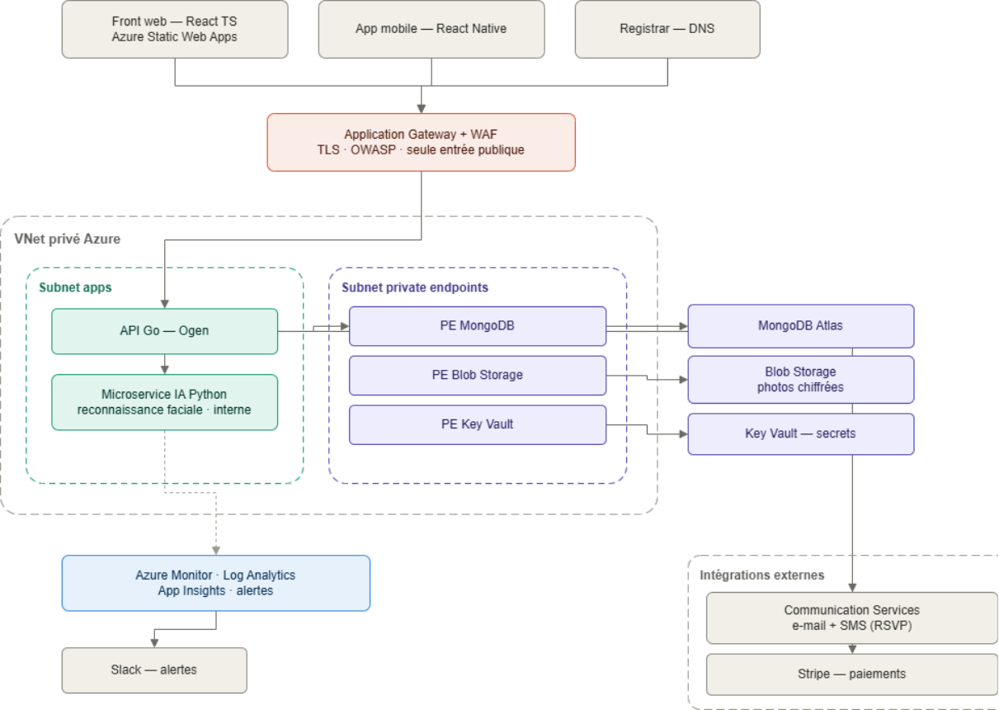
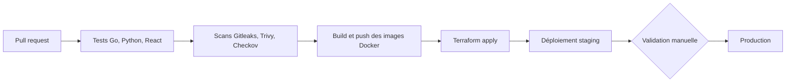

# Choix technologiques

## Frontend – web

### React TS

Le frontend web du projet Moozo est destiné aux invités afin de leur permettre d’accéder facilement aux informations de l’événement sans installation d’application mobile. Le choix de React avec TypeScript répond à cet objectif d’accessibilité, de performance et de maintenabilité.

L’architecture component-based de React facilite le développement de ces fonctionnalités. Par exemple, le plan de table, la galerie de photos ou la liste des invités peuvent être développés sous forme de composants indépendants, réutilisables et facilement maintenables.

React utilise également un mécanisme appelé Virtual DOM, qui optimise la mise à jour de l’interface lorsque les données changent. Cela améliore la fluidité de l’expérience utilisateur dans des interfaces dynamiques où les contenus peuvent être mis à jour en temps réel (par exemple lors du partage de photos ou de l’ajout d’informations sur l’événement).

L’utilisation de TypeScript, développé par Microsoft, permet d’ajouter un typage statique au code JavaScript. Cela améliore la fiabilité de l’application et réduit les erreurs lors de la manipulation de données structurées comme les invités, les tables ou les informations d’événement. Le typage facilite également la maintenance et la collaboration sur un projet de taille importante.

Ainsi, React avec TypeScript constitue un choix adapté pour le frontend web de Moozo en offrant une interface performante, maintenable et accessible aux invités depuis n’importe quel navigateur sans installation préalable.

## Frontend - mobile

### Flutter

L'application mobile du projet Moozo est destinée principalement aux organisateurs et aux prestataires, qui doivent gérer l'événement directement depuis leur smartphone. Pour cela, Flutter a été choisi.

Flutter permet de développer une application mobile multiplateforme (iOS et Android) à partir d'une base de code unique, tout en conservant des performances proches du natif. Contrairement à des solutions basées sur un pont JavaScript, Flutter compile directement en code natif ARM, ce qui garantit une fluidité constante dans les interfaces dynamiques comme le plan de table ou la gestion des invités en temps réel.

Le langage Dart, typé statiquement, apporte les mêmes garanties de fiabilité que TypeScript côté web : détection des erreurs dès la compilation, meilleure maintenabilité et collaboration facilitée sur un projet manipulant de nombreuses entités (événements, invités, tables, photos, prestataires).

Flutter repose sur une architecture à base de widgets, comparable dans son principe à l'approche component-based de React utilisée côté web. Cette proximité conceptuelle (composants réutilisables, gestion d'état, cycle de vie) facilite la montée en compétence de l'équipe et limite la duplication de logique métier entre le web et le mobile, même si les deux stacks restent techniquement distinctes.

Flutter dispose également d'un écosystème mature de packages permettant d'intégrer facilement les fonctionnalités nécessaires à une application événementielle : accès à la caméra, notifications push, gestion des médias et intégration avec les services natifs des plateformes.

Ainsi, Flutter permet de développer une application mobile performante, cohérente sur iOS et Android, adaptée aux besoins des organisateurs et prestataires du projet Moozo, tout en réduisant les efforts de maintenance liés à une base de code mobile unique.

## Backend (API)

Nos choix se font dans l’objectif d’avoir une api rapide et claire, un code lisible et maintenable

### Golang

#### Performance et efficacité

Go est un langage compilé qui produit un binaire natif, ce qui lui confère des performances proches du C sans la complexité de gestion mémoire manuelle. Pour une API REST, cela se traduit par une faible latence et une consommation mémoire réduite, deux critères importants pour un service backend.

#### Lisibilité et maintenabilité

Go impose un style de code unique via gofmt et un ensemble de contraintes volontairement restrictives (pas de surcharge, pas d'héritage, gestion d'erreur explicite). Cela rend le code homogène et facilement lisible par tous les membres d'une équipe, ce qui est particulièrement pertinent dans un contexte de projet en groupe.

#### Simplicité du déploiement

Go compile en un binaire statique autonome, sans runtime externe à installer. Cela simplifie considérablement le déploiement et la conteneurisation.

### Ogen

#### Approche OpenAPI First

Ogen adopte une approche *API First* : le fichier OpenAPI est la source de vérité unique à partir de laquelle le code serveur est entièrement généré (routing, validation, sérialisation). Cela garantit une cohérence permanente entre la documentation et l'implémentation.

#### Réduction du boilerplate

Le développeur n'implémente que la logique métier, sous forme d'une interface Go générée. Tout le code d'infrastructure HTTP est pris en charge par Ogen, ce qui réduit les erreurs et le temps de développement.

#### Sécurité par le compilateur

Si le spec OpenAPI évolue, le compilateur Go signale immédiatement les handlers manquants ou incompatibles. C'est une garantie structurelle de cohérence, plus fiable qu'une convention d'équipe.

## Backend (IA)

Pourquoi l’intégrer dans un microservice séparé ?

- Le backend principal est en GO
- L’IA consomme beaucoup de CPU/RAM
- Les mises à jours du service d’IA et de l’API ne sont pas synchrone
- Rollback/scalabilité indépendant

### Python

- Écosystème ML/IA dominant
- Bibliothèques optimisées
- Communauté très active

### PyTorch

- Syntaxe simple et intuitive, proche du Python natif
- Très utilisé en Computer Vision
- Debug facile grâce à l’exécution en mode dynamique
- Communauté très active

Pourquoi pas TensorFlow ? Plus lourd et complexe, fait pour de gros projets avec beaucoup de stats

## Base de données

### MongoDB

Le projet Moozo manipule plusieurs types d'entités qui évoluent au cours du développement : utilisateurs, événements, invités, tables, photos, demandes de prestations, etc. Pour stocker ces données, nous avons retenu MongoDB.

MongoDB est une base de données orientée document : les données sont stockées sous forme de documents JSON (en BSON en interne). Ce modèle correspond bien aux objets manipulés côté API, ce qui simplifie le passage entre la base et le code applicatif sans passer par un mapping relationnel complexe.

Sur un projet en phase de conception, le modèle de données évolue régulièrement. Avec une base relationnelle, chaque modification de schéma implique une migration. MongoDB n'impose pas de schéma fixe au niveau de la base : ajouter un champ comme un statut RSVP, une préférence alimentaire ou un rôle prestataire ne demande pas de migration. La validation du schéma reste assurée côté API, ce qui garantit la cohérence des données sans bloquer les itérations.

Le modèle document est aussi adapté à des entités riches comme un événement, qui regroupe naturellement plusieurs informations liées (configuration, planning, liste d'invités, tables). Stocker ces informations dans un même document évite des jointures multiples et reste lisible à manipuler.

MongoDB dispose enfin d'un écosystème mature : drivers officiels pour Go et Python, outils d'indexation, sauvegardes et bonne intégration en environnement conteneurisé.

#### Pourquoi pas SQL (PostgreSQL / MySQL) ?

Une base SQL comme PostgreSQL impose un schéma strict et des migrations à chaque évolution du modèle. Cela apporte une garantie d'intégrité forte, mais ralentit les itérations sur un projet où la structure des entités n'est pas encore figée. Pour Moozo, la flexibilité de MongoDB et la rapidité de développement priment sur la rigidité d'un schéma relationnel.

## Infrastructure & déploiement

### Docker

Docker est utilisé pour conteneuriser les services applicatifs de Moozo, notamment l’API Go et le microservice IA Python. Chaque service peut ainsi être empaqueté avec ses dépendances, ce qui garantit un comportement plus stable entre les environnements de développement, de test et de déploiement.

En local, Docker permet de lancer facilement la stack de développement avec docker-compose, incluant l’API, le service IA et une instance MongoDB de test. En environnement cloud, seuls les services applicatifs sont déployés sous forme de conteneurs, tandis que la base de données est hébergée séparément via MongoDB Atlas.

Ce choix simplifie le travail en équipe, limite les problèmes de configuration locale et s’intègre naturellement avec la CI/CD. Les images Docker peuvent être construites automatiquement avec GitHub Actions, stockées dans un registre, puis déployées sur Azure Container Apps.

### Azure

Azure est retenu comme socle cloud principal pour l’infrastructure Moozo. L’objectif n’est pas de mettre en place une infrastructure inutilement complexe, mais de déployer le projet sur un environnement cloud moderne, managé et proche de ce qui est utilisé en entreprise.

Ce choix permet de travailler des sujets importants pour le projet : hébergement applicatif, conteneurisation, stockage des médias, gestion des secrets, supervision, logs et automatisation des déploiements. Azure permet donc de couvrir une grande partie des besoins d’exploitation de Moozo sans devoir administrer manuellement des machines virtuelles.

Ce choix est aussi motivé par la montée en compétence. Moozo est un projet de fin d’études, et l’infrastructure peut servir de support concret pour progresser sur des compétences recherchées : cloud, DevOps, CI/CD, sécurité des accès, monitoring et gestion de services managés. Utiliser Azure permet donc de faire du projet un vrai cas pratique, au-delà d’un simple déploiement local ou d’un VPS classique.

Enfin, Azure reste un choix cohérent pour une application destinée à des utilisateurs français, car il permet d’héberger les ressources dans des régions proches, notamment en France ou en Europe. Cela permet de limiter la latence et de mieux maîtriser la localisation des données, un sujet de plus en plus pris en compte dans les projets numériques.

#### Azure Static Web Apps

Azure Static Web Apps est utilisé pour héberger le frontend web de Moozo. Cette interface permet aux utilisateurs d’accéder aux fonctionnalités de la plateforme depuis un navigateur, selon leur rôle : invité, organisateur, prestataire ou administrateur. Le service est adapté à une application React TS, avec un déploiement simple depuis GitHub, la gestion du HTTPS et la possibilité d’associer un nom de domaine personnalisé.

#### Azure Container Apps

Azure Container Apps est utilisé pour exécuter l’API Go et le microservice IA Python. Ce service permet de déployer des conteneurs sans gérer directement une machine virtuelle ou un cluster Kubernetes. C’est adapté à Moozo, car l’API et le service IA peuvent rester séparés, tout en étant déployés et redimensionnés indépendamment.

En MVP, le mode Consumption permet de limiter les coûts avec une facturation à l’usage. Si l’application devient plus utilisée, le mode Dedicated pourra être envisagé pour une charge plus stable.

#### Azure Blob Storage

Azure Blob Storage est utilisé pour stocker les photos, les plans de salle et les médias liés aux événements. Ces fichiers ne doivent pas être stockés directement dans MongoDB ni sur le disque local d’un serveur. Le stockage objet est plus adapté pour ce type de données, car il est conçu pour gérer des fichiers volumineux et évolutifs.

#### Azure Key Vault

Azure Key Vault est utilisé pour stocker les secrets applicatifs : clés Stripe, URI MongoDB, tokens JWT, clés API, identifiants email ou SMS. Cela évite de mettre des secrets dans le code, dans des fichiers .env partagés ou dans les variables de pipeline sans contrôle. C’est une brique simple mais importante pour rendre l’infrastructure plus propre et plus sécurisée.

#### Azure Monitor + Log Analytics

Azure Monitor et Log Analytics sont utilisés pour centraliser les logs, suivre les erreurs et créer des alertes. L’objectif est d’avoir une application exploitable : savoir si l’API renvoie des erreurs, si le microservice IA plante, ou si un comportement anormal apparaît. Ce n’est pas un SIEM complet, mais c’est suffisant pour une première vraie supervision cloud.

#### GitHub Container Registry / Azure Container Registry

GitHub Container Registry est utilisé dans un premier temps pour stocker les images Docker de l’API Go et du microservice IA Python. Ce choix est cohérent avec la phase de développement du projet, car le code est déjà versionné sur GitHub et les images peuvent être construites automatiquement avec GitHub Actions.

Dans le cadre du projet Moozo, même si l’application est déployée sur Azure, GitHub Container Registry reste suffisant pour le MVP. Il permet de construire, versionner et stocker les images Docker sans ajouter une brique supplémentaire trop tôt dans l’architecture.

Azure Container Registry devient surtout pertinent si Moozo évolue vers une application réellement exploitée ou commercialisée. Dans ce cas, il serait plus logique de stocker les images Docker directement dans l’écosystème Azure, afin de mieux les intégrer avec Azure Container Apps, la gestion des accès, la supervision et les règles de sécurité de l’environnement cloud.

Le choix retenu est donc progressif : GitHub Container Registry pour le développement, le MVP et le déploiement du projet, puis Azure Container Registry en évolution possible si l’application devient un produit réellement exploité.

#### Azure CDN / Front Door

Azure CDN ou Front Door n’est pas nécessaire dès le MVP. Ce service peut être ajouté plus tard si les galeries photos deviennent fortement utilisées. Son rôle serait d’accélérer le chargement des fichiers statiques et des médias, notamment les photos partagées pendant les événements.

#### Azure Communication Services Email & SMS

Azure Communication Services est retenu pour gérer les communications transactionnelles de Moozo. La partie **Email** couvre les emails de vérification de compte, de réinitialisation de mot de passe, d’invitation RSVP, de relance et de notification. La partie **SMS** couvre les messages liés aux RSVP, aux relances et éventuellement à certains codes de vérification.

Ce choix permet de rester dans l’écosystème Azure au lieu d’ajouter des services externes comme Brevo pour l’email ou OVHcloud SMS pour les SMS. Il est donc plus intéressant dans le cadre du projet, car il permet de travailler une brique supplémentaire d’Azure : création du service, configuration du domaine d’envoi, intégration API, gestion des clés, suivi des envois et supervision.

Pour Moozo, l’email et le SMS ne sont pas le cœur du produit, mais ils restent nécessaires dans plusieurs parcours utilisateurs. Utiliser Azure Communication Services permet de couvrir ces besoins sans mettre en place de serveur SMTP auto-hébergé ni multiplier les prestataires externes.

Le SMS reste cependant un coût variable important, car il dépend directement du nombre de messages envoyés. C’est donc un point à prendre en compte dans l’estimation des coûts, surtout dans les scénarios de croissance et de forte utilisation.

### MongoDB Atlas

MongoDB Atlas est retenu pour héberger la base de données Moozo. Ce choix reste cohérent avec l’utilisation de MongoDB déjà prévue dans le projet pour stocker les utilisateurs, événements, invités, RSVP, prestations, messages et données liées à l’organisation des événements.

Atlas évite d’avoir à administrer nous-mêmes un serveur MongoDB. Le service permet de commencer avec une offre gratuite, puis de passer sur une offre plus robuste si le projet prend de l’ampleur.

### GitHub Actions

GitHub Actions est utilisé pour automatiser la CI/CD du projet. Il permet de lancer les tests, vérifier le formatage, construire les images Docker et déclencher les déploiements vers les environnements prévus.

Ce choix est cohérent avec l’utilisation de GitHub pour le versionnement du code. Il permet de garder un workflow simple : les développeurs ouvrent des pull requests, la CI vérifie automatiquement le projet, puis le déploiement peut être lancé de manière contrôlée. Des outils de sécurité peuvent aussi être ajoutés dans le pipeline, comme des scans de secrets, d’images Docker ou de fichiers d’infrastructure.

### Registrar externe

Un registrar externe est retenu pour l’achat du nom de domaine et la gestion DNS. Azure n’apporte pas de valeur particulière pour cette partie du projet. Utiliser un fournisseur spécialisé reste simple, peu coûteux et facilement interchangeable.

Le domaine pourra ensuite pointer vers les services hébergés sur Azure, notamment le frontend web. Cela permet de séparer proprement l’hébergement applicatif de la gestion du nom de domaine.

## Architecture

L’infrastructure de Moozo repose entièrement sur Azure. Les services applicatifs — l’API Go et le microservice de reconnaissance faciale — sont conteneurisés et exécutés sur Azure Container Apps. Le point d’entrée public est l’Application Gateway, équipée d’un pare-feu applicatif (WAF), qui assure la terminaison TLS et le routage vers l’API. Les composants applicatifs, la base de données, le stockage et les secrets sont déployés dans un réseau virtuel privé (VNet) et accessibles uniquement par liaisons privées (Private Link). L’infrastructure est décrite et déployée en Infrastructure as Code avec Terraform.

Caractéristiques principales :

- **Exposition** : un seul point d’entrée public (Application Gateway + WAF). Aucun autre service n’expose d’adresse publique.
- **Communication interne** : authentification entre services par identité managée (Managed Identity) et contrôle d’accès RBAC. Les secrets sont centralisés dans Azure Key Vault.
- **Microservice IA** : déployé en interne au VNet et appelé uniquement par l’API. Les photos sont chiffrées au repos et hébergées en région France.
- **Paiements** : délégués à Stripe.

### Vue d’ensemble



[Lien vers le draw.io](https://drive.google.com/file/d/1K1W0463O5KhdqKzl76UmSDTU8hgPHoV0/view?usp=drive_link)

### Segmentation réseau (VNet)

Région : France Central. VNet 10.20.0.0/16 segmenté par sous-réseaux, chacun doté de son groupe de sécurité réseau (NSG).

| **Sous-réseau** | **CIDR** | **Rôle** | **Contenu** |
|----|----|----|----|
| snet-appgw | 10.20.0.0/24 | Périmètre public | Application Gateway + WAF (IP publique) |
| snet-apps | 10.20.1.0/24 | Compute applicatif | Environnement Azure Container Apps (API Go, IA Python) |
| snet-pe | 10.20.2.0/24 | Accès données privé | Private endpoints (MongoDB, Blob, Key Vault) |

Des zones DNS privées associées au VNet font résoudre les noms managés vers les adresses privées des endpoints. Les environnements staging et prod réutilisent les mêmes modules avec un plan d’adressage distinct.

### Exposition & flux

| **Élément** | **Exposition** | **Détail** |
|----|----|----|
| Application Gateway + WAF | Public | Unique IP publique, termine le TLS, filtre OWASP, route vers l’API. |
| Front web (Static Web Apps) | Public (CDN managé) | Sert les fichiers statiques React ; le navigateur appelle ensuite l’API. |
| API Go | Privé | Ingress interne au VNet, atteignable uniquement derrière l’App Gateway. |
| Microservice IA | Privé strict | Appelé uniquement par l’API Go ; jamais exposé. |
| MongoDB / Blob / Key Vault | Privé (Private Link) | Aucun accès Internet ; trafic via private endpoints. |
| Stripe, Communication Services | Egress sortant | Appels sortants contrôlés depuis l’API. |

### Observabilité

L’API et le microservice IA sont instrumentés via Application Insights (logs, métriques et traces), centralisés dans un espace de travail Log Analytics. Les alertes Azure Monitor sont routées vers Slack et réparties par catégorie : sécurité, ressources et disponibilité. Les sauvegardes reposent sur les snapshots planifiés de MongoDB Atlas et le soft-delete avec versioning du Blob Storage.

### Sécurité & moindre privilège (points de contrôle)

| **Flux** | **Contrôle** |
|----|----|
| Internet → API | Application Gateway + WAF (OWASP), TLS, seule entrée publique. |
| API → Key Vault / Blob / MongoDB | Private Link + Managed Identity : pas de secret en clair, pas de trafic Internet. |
| API → microservice IA | Interne au VNet uniquement, jamais exposé ; appel restreint à l’API. |
| Photos / données biométriques | Chiffrement au repos (Blob), région France, durée de conservation limitée. |
| Paiements | Délégués à Stripe. |
| Secrets | Azure Key Vault, injectés au runtime via Managed Identity ; rien en clair dans git. |
| Firewall réseau | NSG deny par défaut par sous-réseau ; seuls les flux nécessaires sont autorisés. |

### CI/CD & Infrastructure as Code



Une pull request sur develop ou main déclenche GitHub Actions : tests (Go, Python, React) et scans de sécurité (Gitleaks, Trivy, Checkov). Si tout passe, les images Docker sont construites et poussées dans le registre, puis Terraform provisionne l’infrastructure Azure et le déploiement va sur staging, avec validation manuelle avant la production. Aucun merge n’est autorisé si la CI échoue.

Chaque bloc du schéma de la section 1 correspond à un module Terraform :

```text
terraform/
├─ environments/
│ ├─ staging/ (main.tf, terraform.tfvars, backend.tf)
│ └─ prod/ (main.tf, terraform.tfvars, backend.tf)
├─ modules/
│ ├─ network/ VNet, subnets, NSG, zones DNS privées
│ ├─ app_gateway/ Application Gateway + WAF + IP publique + TLS
│ ├─ container_apps/ environnement interne + API Go + IA Python
│ ├─ storage/ compte de stockage + Blob + private endpoint
│ ├─ keyvault/ Key Vault + private endpoint + RBAC
│ ├─ identity/ managed identities + role assignments
│ ├─ observability/ Log Analytics + App Insights + alertes
│ └─ communication/ Azure Communication Services (e-mail / SMS)
├─ providers.tf provider azurerm
└─ versions.tf versions Terraform & providers épinglées
```

Le state Terraform est stocké à distance dans un Blob Azure dédié (verrouillage natif), jamais en local dans git. Ajouter un environnement revient à créer un dossier dans environments/ réutilisant les mêmes modules avec son propre plan d’adressage.

### Reproductibilité

- terraform init / plan / apply par environnement ; state distant dans un Blob Azure.
- Détruire puis reconstruire : terraform destroy puis terraform apply recrée toute l’infra ; le pipeline GitHub Actions redéploie ensuite les images applicatives.
- Un nouvel environnement = un dossier dans environments/ réutilisant les mêmes modules.
