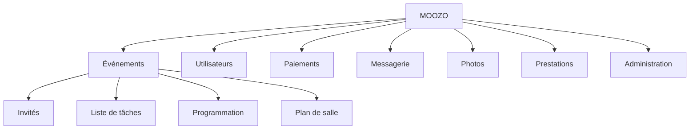

# Contexte du projet

## Contexte

Le secteur de l’événementiel regroupe de nombreux types d’événements : mariages, séminaires, conférences, anniversaires ou événements privés. L’organisation de ces événements nécessite de gérer plusieurs aspects tels que les invités, les informations logistiques, la coordination des prestataires et la communication entre les participants.

Aujourd’hui, une grande partie de ces tâches est réalisée à l’aide d’outils numériques. Cependant, ces outils sont souvent dispersés : tableurs pour gérer les invités, messageries pour communiquer, services de partage de photos ou encore documents PDF pour transmettre les informations. Cette fragmentation complique l’organisation et peut entraîner des pertes de temps ou des erreurs.

Dans ce contexte, les applications numériques dédiées à l’événementiel se développent afin de simplifier l’organisation et d’améliorer l’expérience des participants. L’objectif est de centraliser les informations et les interactions liées à un événement sur une plateforme unique.

## Problématique

Les organisateurs d’événements (mariages, séminaires, anniversaires, conférences…) jonglent entre une multitude d’outils : Excel pour le plan de table, WhatsApp pour les photos, Google pour localiser la salle, PDF pour envoyer les informations, et des recherches interminables pour trouver des prestataires fiables. Cette dispersion crée des pertes de temps, des erreurs et un manque de fluidité le jour J.

## Objectifs

Faire passer l’organisation d’événements en mode smart : un espace unique pour gérer vos évènements. Gérer les invités, plan de table, infos et prestataires de confiance. Les organisateurs gagnent du temps, les invités vivent une expérience fluide et connectée. Moozo : l’app qui simplifie tout, et sublime chaque instant.

Centraliser la gestion d’un évènement sur une seule plateforme permettant à la fois :

- La préparation
- La coordination
- La logistique
- La participation des invités
- L’accès simplifié à une liste de prestataires vérifiés

## Étude de marché, benchmarks concurrents

Plusieurs plateformes proposent des solutions numériques pour l’organisation d’événements.

Par exemple, Eventbrite permet de créer des événements et de gérer les inscriptions ou la billetterie en ligne. Cette solution est principalement utilisée pour des événements publics ou professionnels.

Cvent propose une plateforme complète pour la gestion d’événements professionnels, incluant la gestion des participants et l’organisation logistique. Cependant, ce type d’outil est souvent destiné aux grandes entreprises.

Dans le domaine des événements privés, des plateformes comme Zola ou The Knot permettent de gérer certains aspects de l’organisation, notamment pour les mariages.

L’analyse de ces solutions montre qu’elles se concentrent généralement sur des fonctionnalités spécifiques. Moozo vise donc à proposer une plateforme plus globale permettant de centraliser l’ensemble de l’organisation et de l’expérience des invités au sein d’un même outil.

## Notre valeur ajoutée

Moozo : l’app qui transforme le chaos événementiel en une expérience simple, fluide et intelligente. Invitations, plan de table dynamique, navigation dans la salle, partage de photos, reconnaissance faciale des invités, interactions sociales… et un catalogue complet de prestataires pour organiser un événement du premier clic jusqu’au dernier souvenir.

<https://www.canva.com/design/DAG9ibk2k18/Jv5tn6MfiNnsa8fFqNAJjg/edit?utm_content=DAG9ibk2k18&utm_campaign=designshare&utm_medium=link2&utm_source=sharebutton>

## Product Breakdown Structure (PBS) and Work Breakdown Structure (WBS)

### PBS

PBS (Online chart) - <https://drive.google.com/file/d/1PaLliVYLgcSmRJgNpWVr9xaqJAcRQSXK/view?usp=sharing>

### WBS

WBS (Online chart) - <https://drive.google.com/file/d/12J_B0V4JZ0uawNz7CD1wyiz_hpNKdOqW/view?usp=sharing>

| Domaine | PDF | Diagramme |
|---|---|---|
| Événements | [wbs_evenements.pdf](pdf/wbs/wbs_evenements.pdf) | [wbs_evenements.md](wbs/wbs_evenements.md) |
| Utilisateurs | [wbs_utilisateurs.pdf](pdf/wbs/wbs_utilisateurs.pdf) | [wbs_utilisateurs.md](wbs/wbs_utilisateurs.md) |
| Paiements | [wbs_paiements.pdf](pdf/wbs/wbs_paiements.pdf) | [wbs_paiements.md](wbs/wbs_paiements.md) |
| Messagerie | [wbs_messagerie.pdf](pdf/wbs/wbs_messagerie.pdf) | [wbs_messagerie.md](wbs/wbs_messagerie.md) |
| Photos | [wbs_photos.pdf](pdf/wbs/wbs_photos.pdf) | [wbs_photos.md](wbs/wbs_photos.md) |
| Prestations | [wbs_prestations.pdf](pdf/wbs/wbs_prestations.pdf) | [wbs_prestations.md](wbs/wbs_prestations.md) |
| Administration | [wbs_administration.pdf](pdf/wbs/wbs_administration.pdf) | [wbs_administration.md](wbs/wbs_administration.md) |
